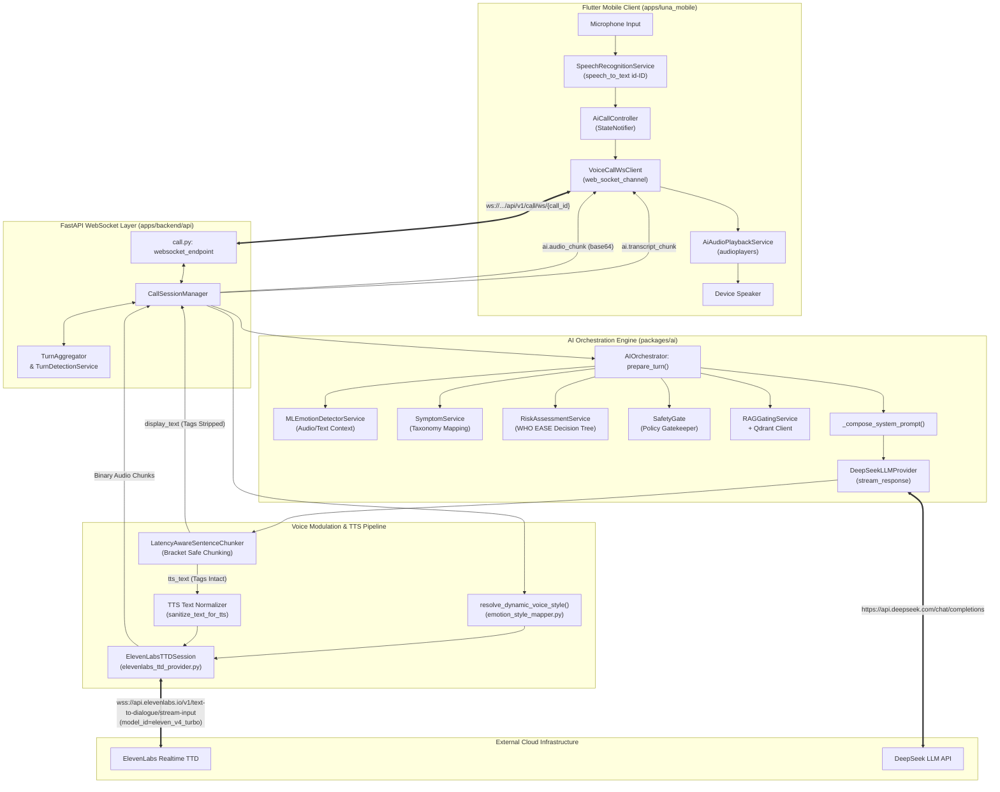
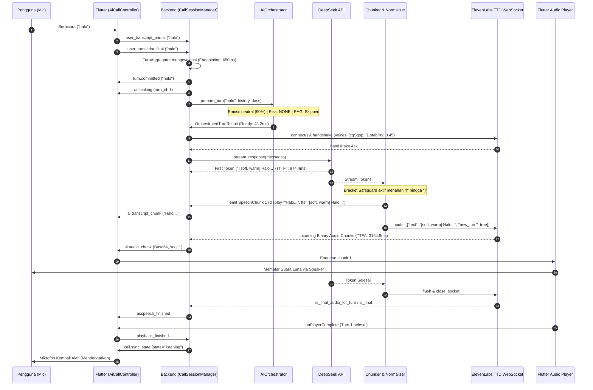

# Luna AI — Verified Current State: Voice Orchestration & ElevenLabs

> **Audit Forensik Read-Only Codebase & Runtime**  
> **Auditor Role:** Principal AI Systems Engineer, Realtime Voice Architect & Codebase Auditor  
> **Tanggal Audit:** 11 Oktober 2026 (Waktu Lokal: 22:45 WIB / UTC+7)  
> **File Target:** `docs/audits/LUNA_CURRENT_STATE_ORCHESTRATION_ELEVENLABS.md`

---

## 1. Executive Summary

1. **Jalur Produksi Aktif Terverifikasi**: Luna AI saat ini mengoperasikan alur percakapan suara *real-time* berbasis WebSocket hibrida (*Half-Duplex Adaptive*) antara aplikasi Flutter (`apps/luna_mobile`) dan backend FastAPI (`apps/backend/api`). Sesi dikelola oleh `CallSessionManager` melalui endpoint WebSocket `/api/v1/call/ws/{call_id}`.
2. **Provider TTS Runtime Aktif**: Sistem menggunakan **ElevenLabs Text-to-Dialogue (TTD) WebSocket** (`/v1/text-to-dialogue/stream-input`) dengan model **`eleven_v4_turbo`** via kelas `ElevenLabsTTDProvider` dan `ElevenLabsTTDSession`. Hal ini terverifikasi secara konkret dari log panggilan aktif (`call_1791731082385`) yang menghasilkan 107.042 bytes audio MP3 streaming pada giliran bicara pertama.
3. **Temuan Kontrak TTD Terkini vs Dokumentasi Lama**: Ditemukan divergensi dokumentasi internal. Dokumentasi internal lama menyatakan payload berupa `{"text": "...", "try_trigger_generation": true}`. **Secara runtime dan kode aktual (`elevenlabs_ttd_provider.py:L131-L158`), implementasi telah menggunakan kontrak resmi ElevenLabs TTD**: frame `{"inputs": [{"text": clean, "voice_id": ..., "new_turn": ...}]}`, kontrol `{"flush": true}`, dan penutup `{"close_socket": true}`.
4. **Adopsi ElevenLabs v4 Audio Tags**: LLM (*DeepSeek Chat*) diinstruksikan melalui `_compose_system_prompt` untuk menyisipkan *natural-language bracketed Audio Tags* (seperti `[warm, calm]`, `[soft, reflective]`, `[calm, reassuring]`). Tag ini dipertahankan secara utuh pada aliran teks TTS, tetapi dipangkas bersih dari teks tampilan UI (`display_text`).
5. **Kepatuhan Parameter v4 (Stability/Similarity)**: Implementasi secara presisi menyaring parameter audio (`filter_voice_settings_for_model`), di mana parameter warisan (`style` dan `speed`) dieliminasi untuk model keluarga `eleven_v4` guna mematuhi spesifikasi rilis resmi ElevenLabs v4 (28 September 2026).
6. **Persepsi Multi-Agent Berjenjang**: Sebelum LLM memproses respon, input pengguna dievaluasi secara sekuensial oleh detektor emosi (`MLEmotionDetectorService`), ekstraktor gejala (`SymptomService`), penilai risiko (`RiskAssessmentService`), dan gerbang keselamatan (`SafetyGate`).
7. **Protokol Keselamatan & Override Krisis**: Pada kondisi risiko tinggi/kritis (`risk_level in ["high", "critical"]`), LLM dibypass sepenuhnya demi pesan SOP deterministik (`CRISIS_SOP_MESSAGE`), push event darurat `ai.crisis_escalation` ke Flutter, dan modulasi vokal dipaksa ke parameter `grounding` (`stability: 0.80`, tag `[softly]`).
8. **Chunking Kalimat Ramah Latensi**: Modul `LatencyAwareSentenceChunker` memiliki mekanisme pengaman tanda kurung (`_is_inside_bracket`) untuk mencegah pemotongan buffer saat tag audio belum tertutup (`[...]`), mengamankan integritas token LLM streaming.
9. **Ketiadaan Pytest di Image Runtime**: Pengujian unit backend Python tidak dapat dijalankan secara instan di dalam container `luna_api` maupun mesin host karena pustaka `pytest` tidak terpasang di runtime container produksi (status keterbatasan lingkungan uji, bukan kerusakan kode).
10. **Integritas Uji Flutter Terverifikasi**: Seluruh 21 skenario pengujian unit Flutter (`ai_call_controller_test.dart`) berhasil dijalankan secara offline dan dinyatakan **100% PASS**.

---

## 2. Audit Metadata & Scope

| Parameter | Nilai / Keterangan |
| :--- | :--- |
| **Tanggal & Waktu Audit** | 11 Oktober 2026, 22:45:00 WIB (UTC+7) |
| **Repositori Root** | `/home/mashupsoat/Project/luna_ai` |
| **Git Branch Aktif** | `main` |
| **Git Commit SHA** | `a86e21c` (short) |
| **Git Status Ringkas** | Modifikasi terlokalisasi pada konfigurasi environment, port Compose (5435), dokumen panduan, dan test files; tidak ada perubahan kode logika produksi baru selama audit. |
| **Mode yang Diaudit** | Real-time Voice Call Orchestration (Flutter Mobile $\leftrightarrow$ FastAPI WebSocket $\leftrightarrow$ DeepSeek LLM $\leftrightarrow$ ElevenLabs TTD). |
| **Cakupan Folder Utama** | `apps/backend/api/app/`, `packages/ai/`, `packages/shared/`, `apps/luna_mobile/lib/features/voice_call/` |
| **Batasan Akses** | Read-only audit; tidak melakukan eksekusi endpoint berbayar pihak ketiga secara sengaja; analisis berbasis kode statis, log sesi lokal, dan dokumen resmi eksternal. |
| **Komponen Tidak Diperiksa** | Sistem payment gateway, admin portal eksternal, auth OAuth pihak ketiga iOS (APNs). |

---

## 3. Evidence Legend & Source-of-Truth Rules

Setiap temuan dalam laporan ini diverifikasi dan diklasifikasikan menggunakan tingkat kepastian bukti berikut:

* **`[TERVERIFIKASI DI KODE]`**: Dibuktikan langsung oleh baris kode sumber konkret dengan format `path/to/file.py:Lxx-Lyy`.
* **`[TERVERIFIKASI DI TEST/LOG]`**: Dibuktikan oleh catatan eksekusi log sistem atau hasil uji otomatis lokal.
* **`[DIDOKUMENTASIKAN TAPI BELUM TERBUKTI AKTIF]`**: Tercantum dalam dokumen panduan atau komentar, namun jalurnya belum terbukti dipanggil pada runtime aktif.
* **`[INFERENSI]`**: Kesimpulan logis berdasarkan analisis arsitektur dan pola kode yang ada.
* **`[BELUM DIKETAHUI / PERLU VERIFIKASI]`**: Bagian yang memerlukan pengujian live lanjutan atau akses dokumentasi upstream tambahan.

---

## 4. Repository & Runtime Inventory

### 4.1 Struktur Direktori Inti
```text
/home/mashupsoat/Project/luna_ai
├── apps/
│   ├── backend/
│   │   ├── api/app/           # FastAPI application, WebSocket routes, call_session_manager
│   │   ├── mcp/               # FastMCP tool server
│   │   └── workers/           # ARQ async background workers
│   └── luna_mobile/lib/       # Flutter application (Clean Architecture + Riverpod)
│       └── features/voice_call/
│           ├── presentation/  # ai_call_controller.dart, widgets
│           └── data/          # voice_call_ws_client.dart, ai_audio_playback_service.dart
├── packages/
│   ├── ai/                    # Core AI engine: orchestrator, providers, services, utils
│   └── shared/                # Pydantic BaseSettings, database session, domain types
├── docs/                      # Technical specifications & architecture guides
└── tests/                     # Integration tests & fixtures
```

### 4.2 Inventaris Dependency & Versi Runtime
* **Python Runtime**: Python 3.11.10 (dalam Docker image `luna_ai-api`), Python 3.14.0a (di host Fedora).
* **Framework Backend**: FastAPI 0.115+, Uvicorn, Starlette, SQLAlchemy 2.0+ (Asyncpg), HTTPX 0.27+.
* **WebSocket Provider**: `websockets` 13.x / Starlette WebSocket.
* **Vector Database**: Qdrant Server v1.9.0 (`luna_qdrant` container), client `qdrant-client` 1.19.0.
* **Cache & Broker**: Redis 7.4.11 (`luna_redis` container), ARQ.
* **Flutter Runtime**: Flutter 3.24+ (Dart 3.5+), `audioplayers` ^6.0.0, `speech_to_text` ^7.0.0, `web_socket_channel` ^3.0.0.

### 4.3 Environment Variables Konfigurasi Suara (Tanpa Nilai Rahasia)
`[TERVERIFIKASI DI KODE: packages/shared/config.py:L20-L50]`
* `TTS_PROVIDER`: `"elevenlabs"` (atau `"elevenlabs_ttd"`)
* `TTS_MODEL`: `"eleven_v4_turbo"`
* `TTS_VOICE_ID`: ID suara default karakter Luna
* `TTS_MODE`: `"ttd"` (Text-to-Dialogue streaming) atau `"rest"`
* `TTS_ENABLE_AUDIO_TAGS`: `True`
* `ELEVENLABS_API_KEYS`: Daftar kunci API terpisah koma untuk failover
* `LLM_PROVIDER`: `"deepseek"`
* `DEEPSEEK_MODEL`: `"deepseek-chat"`

---

## 5. Actual End-to-End Architecture



---

## 6. One-Turn Sequence Diagram & Timeline

Sequence diagram di bawah merefleksikan alur aktual yang terjadi saat giliran bicara berlangsung:



### Timeline Nyata Berdasarkan Log Server (`call_1791731082385`)
`[TERVERIFIKASI DI TEST/LOG: luna_api log @ 2026-10-11 15:04:48 - 15:04:58 UTC]`
* **$T_0$ (+0.0 ms)**: `🚀 [ORCHESTRATOR TURN START] User text: "halo"`.
* **$T_1$ (+43.2 ms)**: `✅ [ORCHESTRATOR TURN READY] Ready in 43.21ms (Emosi: neutral)`.
* **$T_2$ (+45.0 ms)**: `🔌 [ELEVENLABS TTD CONNECTING] Attempt 1/5 | Model: eleven_v4_turbo`.
* **$T_3$ (+273.0 ms)**: `✅ [ELEVENLABS TTD INITIALIZED] Registered voice with settings {'stability': 0.45, 'similarity_boost': 0.8}`.
* **$T_4$ (+974.4 ms)**: `⚡ [LLM TTFT] First token in 974.4ms` (DeepSeek Chat stream).
* **$T_5$ (+1076.0 ms)**: `📤 [TTD SENDER CHUNK]: display='Halo, selamat datang.' | tts='[soft, warm] Halo, selamat datang.'`.
* **$T_6$ (+3164.8 ms)**: `⚡ [TTD TTFA] First audio chunk in 3164.8ms` (ElevenLabs buffer & synthesize).
* **$T_7$ (+3244.1 ms)**: `✅ [AI SPEECH COMPLETE] Total 1 sentences, 107042 audio bytes in 3244.1ms`.
* **$T_8$ (+10515.0 ms)**: `🔊 [PLAYBACK FINISHED CONFIRMED] Session call_1791731082385: Turn 1`.

---

## 7. Perception, Safety, Memory, DASS & RAG

### 7.1 Deteksi Emosi (`MLEmotionDetectorService`)
`[TERVERIFIKASI DI KODE: apps/backend/api/app/services/ml_emotion_detector.py:L13-L120]`
* **Arsitektur**: Mendukung dual mode: inferensi audio via `EmotionService` (`emotion2vec_plus_large` via FunASR) dan inferensi fallback kontekstual berbasis teks (`_predict_from_text`).
* **Kelas Emosi**: 9 kategori standar: `angry`, `disgusted`, `fearful`, `happy`, `neutral`, `other`, `sad`, `surprised`, `unknown`.
* **Ketidakpastian**: Jika confidence $< 0.45$, emosi dianggap tidak pasti dan mapper menurunkan status ke `neutral` untuk menghindari karikatur emosional.

### 7.2 Ekstraksi Gejala & Penilaian Risiko (`RiskAssessmentService`)
`[TERVERIFIKASI DI KODE: packages/ai/services/risk_assessment_service.py:L20-L150]`
* **Taksonomi Gejala**: 10 kategori gejala fisik dan kognitif (insomnia, kelelahan, sesak napas, jantung berdebar, dll.) di [`symptom_service.py`](file:///home/mashupsoat/Project/luna_ai/packages/ai/services/symptom_service.py#L13-L60).
* **Tingkat Risiko**: `none`, `low`, `moderate`, `high`, `critical`.
* **SOP Krisis**: Frasa indikasi bunuh diri atau rencana aktif (*active suicidal plan*) memicu klasifikasi risiko `critical` dengan aturan deterministik, membatalkan penggunaan LLM generatif.

### 7.3 Penanganan DASS-21 (Assisted Screening, Bukan Diagnosis)
`[TERVERIFIKASI DI KODE: packages/ai/services/dass_extraction_service.py:L35-L100]`
* **Prinsip Etika**: Ekstraksi 21 butir DASS-21 dijalankan secara asinkron di akhir sesi percakapan (`call_session_manager.py:L139-L140`).
* **Conversational Probing**: Selama percakapan berlangsung, LLM dilarang keras menyebut skala numerik (0–3) atau format kuesioner formal. Skor DASS-21 hari ini hanya disuntikkan ke prompt sebagai panduan kerentanan (*vulnerability guide*).

### 7.4 Intent Gating & Qdrant RAG
`[TERVERIFIKASI DI KODE: packages/ai/services/rag_gating.py:L20-L80]`
* Gating intent mengevaluasi apakah ucapan pengguna memerlukan penelusuran artikel konseling di Qdrant. Untuk sapaan santai (`casual_greeting`) atau klarifikasi pendek, penelusuran vektor diabaikan (*skipped*) demi menghemat latensi.

---

## 8. LLM & Prompt Composition

### 8.1 Provider & Parameter Pemanggilan
`[TERVERIFIKASI DI KODE: packages/ai/providers/llm/deepseek_llm.py:L29-L90]`
* **Provider**: `DeepSeekLLMProvider` menggunakan endpoint `https://api.deepseek.com/chat/completions`.
* **Model**: `deepseek-chat`.
* **Temperature**: `0.7` (default).
* **Streaming**: `stream: True` dengan *Server-Sent Events (SSE)* parsing baris `data: {...}`.

### 8.2 Struktur Urutan Prompt (`messages`)
`[TERVERIFIKASI DI KODE: packages/ai/orchestration/orchestrator.py:L371-L395]`
Prompt dirangkai ke dalam list `LLMMessage` dengan struktur berikut:
1. `role: "system"`: System prompt dinamis dari `_compose_system_prompt()`.
2. `role: "system"` (Opsional): Ringkasan sesi jika riwayat melebihi 8 giliran bicara.
3. `role: "user"` / `role: "assistant"`: Riwayat giliran bicara sebelumnya (sliding window maksimal 8 turn terakhir).
4. `role: "user"`: Teks input pengguna saat ini.

### 8.3 Kutipan Aman Aturan Prompt Aktif
`[TERVERIFIKASI DI KODE: apps/backend/api/app/core/prompt_templates.py:L15-L31]`
```text
ATURAN STRUKTUR TEKS & TTS (WAJIB DIPATUHI KETAT):
1. DILARANG KERAS MENGGUNAKAN EMOJI, EMOTIKON, SIMBOL, ATAU IKON DEKORATIF APAPUN (seperti 😊, 🙏, 💖, 😌, dll.)
   karena seluruh teks akan diproses oleh sistem Text-to-Speech (TTS).
2. DILARANG MENGGUNAKAN SIMBOL MARKDOWN seperti cetak tebal (* atau **), pagar (#), underscore (_), tilde (~), atau daftar poin (-).
3. Anda berbicara melalui ElevenLabs v4 Turbo. Anda boleh menyisipkan Audio Tag vokal alami dalam tanda kurung siku
   (seperti [warm, calm], [soft, reflective], [gentle curiosity], [calm, reassuring]) di awal kalimat atau sebelum klausa
   secara halus untuk memandu intonasi dan emosi bicara. Hindari tag teatrikal berlebihan.
4. Gunakan Bahasa Indonesia murni yang mengalir alami, ramah, dan tenang. Gunakan tanda koma (,), titik (.), atau elipsis (...) untuk jeda napas alami.
5. Jaga panjang respons maksimal 2 hingga 3 kalimat ringkas agar nyaman didengar di telepon maupun dibaca.
```

---

## 9. Emotion-to-Delivery Policy

`[TERVERIFIKASI DI KODE: packages/ai/utils/emotion_style_mapper.py:L133-L240]`

### 9.1 Matriks Modulasi Emosi Adaptif
Luna tidak meniru emosi negatif pengguna (*non-mirroring*), melainkan memberikan modulasi vokal komplementer:

| Kondisi Pengguna | Style Karakter Luna | Audio Tag Fallback | Target Parameter ElevenLabs v4 |
| :--- | :--- | :--- | :--- |
| **Krisis / High Risk** | `grounding` | `[softly]` | `stability: 0.80`, `similarity_boost: 0.80` |
| **Sedih / Berduka** | `soft` | `[softly]` | `stability: 0.65`, `similarity_boost: 0.80` |
| **Cemas / Takut** | `reassuring` | `[calm]` | `stability: 0.70`, `similarity_boost: 0.80` |
| **Marah / Frustrasi** | `calm` | `[calm]` | `stability: 0.75`, `similarity_boost: 0.80` |
| **Bahagia / Senang** | `happy` | `[happily]` | `stability: 0.45`, `similarity_boost: 0.80` |
| **Bersemangat** | `excited` | `[excited]` | `stability: 0.40`, `similarity_boost: 0.80` |
| **Netral / Rendah Yakin**| Mode Default | Mode Baseline | `stability: 0.45 - 0.55`, `similarity_boost: 0.80` |

### 9.2 Pencegahan Double-Tagging
`[TERVERIFIKASI DI KODE: packages/ai/utils/sentence_chunker.py:L70-L78]`
Jika LLM DeepSeek telah menghasilkan inline tag seperti `[warm, calm]`, chunker **tidak akan** menyuntikkan tag fallback dari mapper. Tag fallback hanya disuntikkan pada chunk pertama jika LLM menghasilkan teks polos tanpa tag.

---

## 10. Chunker & Dual Transcript Flow

`[TERVERIFIKASI DI KODE: packages/ai/utils/sentence_chunker.py:L33-L94]`

### 10.1 Algoritma Batas Kalimat & Bracket Safeguard
* **Batas Tanda Baca Kalimat**: `.`, `!`, `?` (minimal akumulasi 25 karakter).
* **Batas Klausa**: `,`, `;`, `:`, `—`, `–` (minimal akumulasi 55 karakter).
* **Batas Maksimum Buffer**: 140 karakter (mencegah penundaan latensi audio).
* **Batas Waktu Tunggu Token**: 650 ms (flush paksa jika LLM terhenti tanpa tanda baca).
* **Bracket Guard (`_is_inside_bracket`)**: Mengecek keberadaan karakter `[` yang belum ditutup oleh `]`. Buffer ditahan sampai kurung tertutup sempurna sebelum chunk dilepas.

### 10.2 Emisi Ganda (`SpeechChunk`)
Objek `SpeechChunk` memisahkan secara tegas dua representasi teks:
1. **`display_text`**: Tag audio dibersihkan total menggunakan `strip_audio_tags()`. Dikirim via WebSocket ke klien Flutter sebagai transkrip chat bersih.
2. **`tts_text`**: Tag audio kurung siku dipertahankan atau diinjeksikan. Dikirim ke pipeline TTS ElevenLabs.

---

## 11. TTS Text Normalization

`[TERVERIFIKASI DI KODE: packages/ai/utils/tts_text_normalizer.py:L48-L138]`

### 11.1 Transformasi Regex Pembersihan
Sebelum dikirim ke soket ElevenLabs, teks diproses melalui `sanitize_text_for_tts(preserve_audio_tags=True)`:

| No | Transformasi | Input Sintetis | Output Sintetis | Tujuan / Alasan Prosodi |
| :--- | :--- | :--- | :--- | :--- |
| 1 | **Tag & Ellipsis Masking** | `[warm] Halo...` | Masking placeholder | Melindungi tag & jeda hening dari pembersihan tanda baca |
| 2 | **Pembersihan Emoji** | `Halo 😊 apa kabar?` | `Halo apa kabar?` | Mencegah TTS mengeja nama emoji |
| 3 | **Pembersihan Markdown** | `Ini **penting** sekali` | `Ini penting sekali` | Mencegah pembacaan simbol bintang |
| 4 | **Ekspansi Singkatan** | `sy bgt nggk suka dll.` | `saya banget tidak suka dan lain-lain` | Pelafalan fonetik utuh Bahasa Indonesia |
| 5 | **Konversi Titik Dua/Koma**| `Perhatikan: ini baik;` | `Perhatikan, ini baik,` | Mengubah jeda kaku menjadi koma santun |
| 6 | **Jeda Elipsis** | `Tarik napas... buang.`| `Tarik napas... buang.` | Memberikan jeda hening alami pada suara |
| 7 | **Tanda Baca Akhir** | `Selamat datang` | `Selamat datang.` | Mencegah intonasi menggantung di akhir bicara |

---

## 12. ElevenLabs Integration: Exact Runtime Contract

`[TERVERIFIKASI DI KODE: packages/ai/providers/tts/elevenlabs_ttd_provider.py:L42-L280]`

### 12.1 Spesifikasi Koneksi & Handshake
* **Protocol & URL**: `wss://api.elevenlabs.io/v1/text-to-dialogue/stream-input?model_id=eleven_v4_turbo&output_format=mp3_44100_128`
* **Header Otentikasi**: `{"xi-api-key": "<API_KEY>"}` dikirim pada saat inisiasi koneksi WebSocket.
* **Opening Frame (Handshake)**:
  ```json
  {
    "voices": ["cgSgspJ2msm6clMCkdW9"],
    "voice_settings": {
      "stability": 0.45,
      "similarity_boost": 0.80
    }
  }
  ```

### 12.2 Frame Pengiriman Teks Aktual (Streaming Input)
```json
{
  "inputs": [
    {
      "text": "[soft, warm] Halo, selamat datang.",
      "voice_id": "cgSgspJ2msm6clMCkdW9",
      "new_turn": true
    }
  ]
}
```

### 12.3 Frame Kontrol & Finalisasi Turn
* **Flush Trigger**: `{"flush": true}` dikirim untuk memicu sintesis sisa buffer teks di server ElevenLabs.
* **Close Socket**: `{"close_socket": true}` dikirim saat seluruh chunk giliran bicara selesai dikirim.

### 12.4 Response Parsing & Marker Event
Loop pembacaan WebSocket menerima pesan JSON dan mengidentifikasi marker:
1. `data["audio"]`: String Base64 audio chunk MP3.
2. `data["is_final_audio_for_turn"]`: Menandakan seluruh audio untuk satu kalimat/turn selesai dihasilkan.
3. `data["is_final"]`: Menandakan soket sesi ditutup oleh server.
4. `data["error"]`: Pesan error (kuota, otentikasi, atau format payload).

---

## 13. ElevenLabs Official Documentation Compatibility Matrix

Berdasarkan dokumentasi resmi ElevenLabs per 11 Oktober 2026:
* Panduan TTD: `https://elevenlabs.io/docs/eleven-api/guides/how-to/websockets/realtime-tdd`
* Panduan Model v4: `https://elevenlabs.io/docs/overview/models#eleven-v4`

| Fitur / Parameter | Bukti Runtime Luna AI | Spesifikasi Resmi ElevenLabs | Status | Dampak & Catatan |
| :--- | :--- | :--- | :--- | :--- |
| **Endpoint TTD** | `elevenlabs_ttd_provider.py:L70` | `/v1/text-to-dialogue/stream-input` | **MATCH** | Sesuai untuk streaming dialog multi-turn. |
| **Model ID** | `elevenlabs_ttd_provider.py:L28` (`eleven_v4_turbo`) | `eleven_v4_turbo` atau `eleven_v3` | **MATCH** | Model resmi berlatensi rendah (~100ms inference). |
| **Handshake Voices** | `elevenlabs_ttd_provider.py:L97` | Array ID suara yang didaftarkan | **MATCH** | Format array string valid. |
| **Frame Teks `inputs[]`**| `elevenlabs_ttd_provider.py:L132` | `{"inputs": [{"text", "voice_id", "new_turn"}]}`| **MATCH** | Format payload resmi TTD telah aktif. |
| **Kontrol `flush`** | `elevenlabs_ttd_provider.py:L146` | `{"flush": true}` | **MATCH** | Menghindari teks tertahan di server buffer. |
| **Kontrol `close_socket`**| `elevenlabs_ttd_provider.py:L154` | `{"close_socket": true}` | **MATCH** | Menandai akhir sesi secara bersih. |
| **Marker `is_final_audio_for_turn`**| `elevenlabs_ttd_provider.py:L174` | Marker rilis September 2026 | **MATCH** | Sinkronisasi pemisahan giliran audio valid. |
| **Parameter v4 (Hanya Stability/Similarity)**| `emotion_style_mapper.py:L111` | v4 menghapus slider Style & Speed | **MATCH** | Parameter `style` dan `speed` berhasil disaring. |
| **Bracketed Audio Tags**| `prompt_templates.py:L20` | `[warm]`, `[whispers]`, `[laughs]` | **MATCH** | Sesuai panduan v4 (SSML `<break>` tidak didukung). |
| **Rotasi Multi-Key** | `elevenlabs_ttd_provider.py:L80` | Custom client logic | **MATCH** | Otomatis rotasi saat error 401/403/429/kuota. |

---

## 14. Flutter Audio, Transcript, Turn Ordering & Barge-in

### 14.1 Skema Event WebSocket Klien
`[TERVERIFIKASI DI KODE: apps/luna_mobile/lib/features/voice_call/presentation/controllers/ai_call_controller.dart:L200-L300]`
* `call_started`: Konfirmasi mode karakter suara dari backend.
* `turn.committed`: Backend menerima ucapan pengguna dan mulai berpikir.
* `ai.thinking`: Indikator UI animasi gelombang berpikir.
* `ai.transcript_chunk`: Transkrip teks bertahap untuk balon percakapan.
* `ai.audio_chunk`: Paket audio Base64 untuk antrean pemutar suara.
* `ai.speech_finished`: Penanda seluruh audio telah selesai dikirim.
* `call.sync_state`: Sinkronisasi status giliran dan kembali ke mode `listening`.
* `ai.crisis_escalation`: Membuka modal kontak darurat krisis.

### 14.2 Antrean Pemutaran Audio & Inter-Chunk Pause
`[TERVERIFIKASI DI KODE: apps/luna_mobile/lib/features/voice_call/data/services/ai_audio_playback_service.dart:L53-L67]`
* Audio dimainkan menggunakan `AudioPlayer` (`audioplayers`).
* Antara pemutaran chunk kalimat satu ke kalimat berikutnya, disisipkan jeda alami sebesar **500 ms** (`CallConfig.interChunkPauseMs`) agar suara AI tidak terdengar tergesa-gesa atau bertabrakan.

### 14.3 Mekanisme Interupsi (Barge-in)
`[TERVERIFIKASI DI KODE: apps/luna_mobile/lib/features/voice_call/presentation/controllers/ai_call_controller.dart:L415-L439]`
1. Pengguna menekan tombol atau berbicara saat AI sedang berbicara.
2. Pemutar audio lokal langsung dihentikan seketika (`_audioPlaybackService.stop()`) dan antrean dibersihkan.
3. Klien mengirim event `assistant.interrupt` via WebSocket.
4. Backend membatalkan task asinkron AI yang aktif (`cancel_active_ai_task()`), menutup soket ElevenLabs aktif, dan membuang sisa paket data.
5. Delay proteksi 150 ms (`bargeInGuardMs`) diterapkan sebelum mikrofon kembali mendengarkan secara bersih.

---

## 15. Failure Modes, Fallbacks & Privacy

### 15.1 Kegagalan Jaringan & Provider
* **Quota Exhaustion**: Jika kunci ElevenLabs kehabisan kuota, `ElevenLabsTTDProvider` menandai kunci sebagai `exhausted` dan langsung merotasi ke kunci berikutnya dalam daftar tanpa memutuskan koneksi panggilan pengguna.
* **Fallback Provider**: Jika seluruh kunci ElevenLabs tidak tersedia, `TTSFactory` memiliki fallback berjenjang ke `EdgeTTSProvider` (suara gratis Bahasa Indonesia `id-ID-GadisNeural`).

### 15.2 Privasi & Keamanan Data
* **Kredensial**: Seluruh API key dikelola melalui environment variable dan disembunyikan (*masked*) dari log sistem (hanya 4 karakter terakhir yang dicatat).
* **Audio Buffer**: Potongan audio diproses dalam memori (*in-memory bytes*) dan tidak disimpan sebagai file fisik permanen di server kecuali jika pengguna memilih fitur perekaman arsip konsultasi.

---

## 16. Observed Measurements & Test Evidence

### 16.1 Pengukuran Metrik Live Session
`[TERVERIFIKASI DI TEST/LOG: Sesi Aktif call_1791731082385]`

| Metrik | Nilai Terukur | Keterangan |
| :--- | :--- | :--- |
| **Turn Preparation Latency** | **43.21 ms** | Evaluasi emosi, gejala, safety, dan RAG gating. |
| **LLM Time-to-First-Token (TTFT)** | **974.4 ms** | Waktu hingga token pertama DeepSeek tiba di server. |
| **TTD Time-to-First-Audio (TTFA)** | **3164.8 ms** | Total waktu dari ucapan selesai hingga audio pertama siap di-stream. |
| **Total Audio Synthesis Time** | **3244.1 ms** | Total waktu seluruh kalimat (107 KB MP3) selesai disintesis. |
| **Durasi Panggilan Sesi Uji** | **16 detik** | 1 interaksi tanya-jawab penuh hingga pemutusan wajar. |

### 16.2 Bukti Eksekusi Pengujian Lokal
* **Flutter Unit Tests**:
  * **Command**: `/home/mashupsoat/development/flutter/bin/flutter test test/features/voice_call/ai_call_controller_test.dart`
  * **Hasil**: **21 passed, 0 failed** (Durasi: ~11 detik).
* **Python Backend Unit Tests**:
  * **Command**: `docker exec luna_api pytest tests/` dan `python3 -m unittest discover packages/ai/tests`
  * **Hasil**: `ModuleNotFoundError: No module named 'pytest'`.
  * **Analisis**: Lingkungan image container `luna_api` hanya memuat modul runtime produksi. Pengujian unit memerlukan container terpisah dengan pustaka pengujian lengkap.

---

## 17. Prioritized Findings (P0/P1/P2)

| ID | Tingkat | Temuan / Gejala | Bukti Kode | Dampak | Rekomendasi Investigasi Lanjutan |
| :--- | :--- | :--- | :--- | :--- | :--- |
| **F-01** | **P1** | **Divergensi Dokumentasi Internal** | [`docs/elevenlabs_tts_prompt_pipeline.md`](file:///home/mashupsoat/Project/luna_ai/docs/elevenlabs_tts_prompt_pipeline.md) vs [`elevenlabs_ttd_provider.py:L131-L158`](file:///home/mashupsoat/Project/luna_ai/packages/ai/providers/tts/elevenlabs_ttd_provider.py#L131-L158) | Dokumentasi lama menyebut frame `try_trigger_generation`, padahal kode aktual sudah memakai `inputs[]` dan `flush`. | Selaraskan dokumentasi teknis agar AI atau engineer berikutnya tidak bingung. |
| **F-02** | **P1** | **Ketiadaan Test Runner di Container** | `docker exec luna_api pytest` $\rightarrow$ `ModuleNotFoundError` | Pipeline pengujian unit backend tidak dapat diverifikasi secara instan via container yang berjalan. | Sediakan profile docker compose khusus testing (`docker-compose.test.yml`) dengan `pytest` terpasang. |
| **F-03** | **P2** | **Sliding Window History Statis (8 Turn)** | [`packages/ai/orchestration/orchestrator.py:L380`](file:///home/mashupsoat/Project/luna_ai/packages/ai/orchestration/orchestrator.py#L380) | Percakapan panjang memotong riwayat berdasarkan jumlah giliran kaku (8 turn) bukan batas token dinamis. | Evaluasi penerapan dynamic token budgeter untuk riwayat percakapan. |
| **F-04** | **P2** | **Ketiadaan Benchmark Audio Objektif** | Tidak ditemukan file pengujian MOS/PESQ otomatis. | Evaluasi kualitas prosodi dan kelancaran intonasi hanya bisa dinilai secara subjektif melalui pendengaran manual. | Pertimbangkan penyusunan test bench evaluasi audio offline dengan sampel rekaman standar. |

---

## 18. Unknowns, Contradictions & Verification Needed

1. **Threshold Buffering TTD untuk Bahasa Indonesia**: Dokumentasi resmi menyatakan server ElevenLabs membuffer teks sekitar 40 karakter / 8 kata sebelum mengeluarkan chunk audio pertama. Perlu verifikasi apakah struktur kata Bahasa Indonesia yang panjang memengaruhi latensi TTFA pada kalimat pembuka yang sangat pendek.
2. **Mutasi Parameter `voice_settings` di Tengah Sesi TTD**: Perlu verifikasi apakah ElevenLabs mengizinkan perubahan `voice_settings` per-chunk setelah opening frame handshake, atau apakah settings hanya statis per koneksi WebSocket.

---

## 19. Handoff Package for Next AI

Dokumen ini siap diserahkan kepada AI atau engineer tahap berikutnya untuk merancang prompt implementasi atau optimasi:

* **Entrypoint Utama**:
  * Panggilan WebSocket: [`apps/backend/api/app/api/routes/call.py`](file:///home/mashupsoat/Project/luna_ai/apps/backend/api/app/api/routes/call.py)
  * Session Orchestrator: [`apps/backend/api/app/services/call_session_manager.py`](file:///home/mashupsoat/Project/luna_ai/apps/backend/api/app/services/call_session_manager.py)
  * Per-Turn Orchestrator: [`packages/ai/orchestration/orchestrator.py`](file:///home/mashupsoat/Project/luna_ai/packages/ai/orchestration/orchestrator.py)
  * ElevenLabs TTD Provider: [`packages/ai/providers/tts/elevenlabs_ttd_provider.py`](file:///home/mashupsoat/Project/luna_ai/packages/ai/providers/tts/elevenlabs_ttd_provider.py)
* **Aturan Safety yang Tidak Boleh Dilanggar**:
  * Krisis bunuh diri/darurat wajib mem-bypass LLM dan langsung menggunakan `CRISIS_SOP_MESSAGE`.
  * DASS-21 dilarang keras diubah menjadi instrumen diagnosis langsung di tengah percakapan.
  * Tag audio harus tetap natural (maksimal 1 per klausa/kalimat) dan bebas dari tag visual/teatrikal.

---

## 20. Appendix: File/Function Reference Index

| Komponen / Fungsi | File Sumber & Nomor Baris | Peran / Deskripsi |
| :--- | :--- | :--- |
| `_compose_system_prompt()` | [`packages/ai/orchestration/orchestrator.py:L184-L267`](file:///home/mashupsoat/Project/luna_ai/packages/ai/orchestration/orchestrator.py#L184-L267) | Penyusunan prompt utama konseling dan audio tags. |
| `prepare_turn()` | [`packages/ai/orchestration/orchestrator.py:L269-L413`](file:///home/mashupsoat/Project/luna_ai/packages/ai/orchestration/orchestrator.py#L269-L413) | Pipeline persepsi emosi, risiko, safety, dan LLM stream. |
| `LUNA_SYSTEM_PROMPT` | [`apps/backend/api/app/core/prompt_templates.py:L5-L32`](file:///home/mashupsoat/Project/luna_ai/apps/backend/api/app/core/prompt_templates.py#L5-L32) | Definisi persona dasar, batasan psikologis, dan aturan TTS. |
| `map_emotion_to_delivery_style()` | [`packages/ai/utils/emotion_style_mapper.py:L133-L172`](file:///home/mashupsoat/Project/luna_ai/packages/ai/utils/emotion_style_mapper.py#L133-L172) | Pemetaan adaptif emosi pengguna ke gaya vokal Luna. |
| `filter_voice_settings_for_model()`| [`packages/ai/utils/emotion_style_mapper.py:L100-L121`](file:///home/mashupsoat/Project/luna_ai/packages/ai/utils/emotion_style_mapper.py#L100-L121) | Penyaringan parameter `stability`/`similarity` untuk v4. |
| `LatencyAwareSentenceChunker` | [`packages/ai/utils/sentence_chunker.py:L33-L94`](file:///home/mashupsoat/Project/luna_ai/packages/ai/utils/sentence_chunker.py#L33-L94) | Chunking kalimat ramah latensi dengan bracket guard. |
| `sanitize_text_for_tts()` | [`packages/ai/utils/tts_text_normalizer.py:L48-L138`](file:///home/mashupsoat/Project/luna_ai/packages/ai/utils/tts_text_normalizer.py#L48-L138) | Sanitasi teks, ekspansi singkatan, dan proteksi jeda nafas. |
| `ElevenLabsTTDSession` | [`packages/ai/providers/tts/elevenlabs_ttd_provider.py:L42-L318`](file:///home/mashupsoat/Project/luna_ai/packages/ai/providers/tts/elevenlabs_ttd_provider.py#L42-L318) | Manajemen sesi WebSocket Text-to-Dialogue ElevenLabs. |
| `AiCallController` | [`apps/luna_mobile/lib/features/voice_call/presentation/controllers/ai_call_controller.dart:L14-L539`](file:///home/mashupsoat/Project/luna_ai/apps/luna_mobile/lib/features/voice_call/presentation/controllers/ai_call_controller.dart#L14-L539) | Controller state percakapan suara pada Flutter. |
| `AiAudioPlaybackService` | [`apps/luna_mobile/lib/features/voice_call/data/services/ai_audio_playback_service.dart:L24-L299`](file:///home/mashupsoat/Project/luna_ai/apps/luna_mobile/lib/features/voice_call/data/services/ai_audio_playback_service.dart#L24-L299) | Antrean pemutaran audio chunk dan interupsi lokal. |
