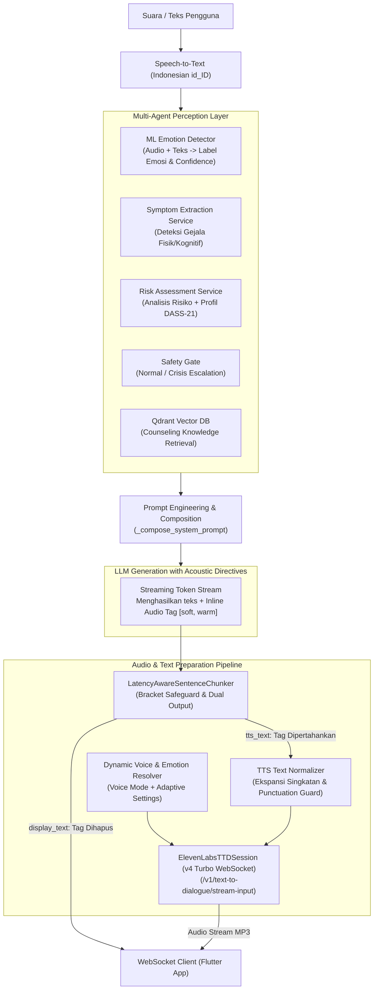

# Luna AI: End-to-End Pipeline — Dari Main Prompt hingga Struktur Kalimat & Audio Tagging ElevenLabs v4

Dokumen ini menjelaskan secara teknis dan komprehensif alur kerja (*end-to-end pipeline*) pembuatan prompt, orkestrasi bahasa, normalisasi kalimat, hingga modulasi audio tag untuk **ElevenLabs Text-to-Dialogue (v4 Turbo)** pada sistem percakapan konseling Luna AI.

---

## 1. Arsitektur Aliran Data (High-Level Overview)



---

## 2. Pembuatan Main System Prompt (`_compose_system_prompt`)

Penyusunan prompt utama berada di [`packages/ai/orchestration/orchestrator.py`](file:///home/mashupsoat/Project/luna_ai/packages/ai/orchestration/orchestrator.py) dan templat dasar konseling di [`apps/backend/api/app/core/prompt_templates.py`](file:///home/mashupsoat/Project/luna_ai/apps/backend/api/app/core/prompt_templates.py).

### 2.1 Komponen Pembentuk System Prompt
Prompt dibangun secara dinamis setiap giliran bicara (*per-turn dynamic assembly*):

1. **Persona Konselor**:
   - Identitas: Luna, konselor pendamping kesehatan mental AI yang hangat, ramah, dan bebas penghakiman (*non-judgmental*).
   - Validasi emosi sebelum memberikan pertanyaan terbuka atau refleksi.
2. **Kondisi Observasi Pengguna (Real-time Perception)**:
   - Status emosi terobservasi: misal `'anxious'` dengan tingkat keyakinan 92%.
   - Profil psikometris terkini (skor DASS-21: Depresi, Kecemasan, Stres).
   - Memori kumulatif percakapan terdahulu jika tersedia.
3. **Kontekstualisasi Sapaan Pengguna**:
   - Menyapa nama pengguna secara natural (misal: "Halo Budi...") tanpa menyebut nama secara kaku di setiap kalimat.
4. **Knowledge Retrieval (RAG)**:
   - Potongan panduan konseling ringkas dari Qdrant (jika bukan sapaan santai biasa).
5. **Aturan Format Suara (Voice & TTS Guardrails)**:
   - **Panjang respon**: 1 hingga 3 kalimat ringkas (format panggilan telepon nyata).
   - **Dilarang keras**: Emoji dekoratif (`😊`, `🙏`), simbol Markdown (`**`, `#`, `-`, `*`), singkatan (`yg`, `dll.`), atau penjelasan ensiklopedia panjang.
   - **Punctuation Napas Alami**: Menggunakan koma (`,`), titik (`.`), atau elipsis (`...`) untuk mengatur tempo bicara TTS.

### 2.2 Instruksi Khusus Audio Tag ElevenLabs v4 Turbo
System prompt menyuntikkan instruksi khusus pengendali vokal ElevenLabs v4 Turbo:

```text
Pengendali Vokal & Emosi ElevenLabs v4 Turbo (Audio Tags):
Anda berbicara melalui ElevenLabs v4 Turbo. Gunakan konteks emosi dan percakapan untuk menentukan ekspresi vokal yang tepat.
Anda dapat menyisipkan Audio Tag vokal alami dalam kurung siku di awal kalimat atau sebelum klausa, contoh:
- [warm, calm] untuk pembukaan atau respons yang hangat dan menenangkan.
- [soft, reflective] untuk validasi emosi dan empati reflektif.
- [gentle curiosity] untuk pertanyaan terbuka yang lembut dan penuh perhatian.
- [calm, reassuring] untuk menenangkan kecemasan, kebingungan, atau kegelisahan.
- [chuckles] atau [slightly amused] hanya untuk momen santai/humor yang menyenangkan.

ATURAN KETAT AUDIO TAG KONSELING:
- Gunakan tag secara hemat dan bermakna (maksimal 1 tag per klausa/kalimat).
- Jaga respon tetap tenang, halus, dan non-teatrikal. DILARANG KERAS tag dramatis: [crying], [screaming], [terrified], [shouting], [panicking].
- DILARANG tertawa ([chuckles]) pada situasi sedih, krisis, atau masalah berat.
- Gunakan HANYA tag pendengaran vokal. DILARANG tag visual fisik seperti [smiling], [nodding].
- Gunakan elipsis (...) untuk jeda hening alami.
```

---

## 3. Resolusi Suara Dinamis & Voice Settings (`resolve_dynamic_voice_style`)

Diimplementasikan pada [`packages/ai/utils/emotion_style_mapper.py`](file:///home/mashupsoat/Project/luna_ai/packages/ai/utils/emotion_style_mapper.py).

### 3.1 Kontrak Karakter & Modulasi Empati
Luna tidak mencerminkan (*mirroring*) emosi negatif pengguna, melainkan menerapkan **Empathetic Adaptive Modulation**:

| Emosi Pengguna | Delivery Style Luna | Fallback Tag | Target Vokal |
| :--- | :--- | :--- | :--- |
| **Krisis / High Risk** | `grounding` | `[softly]` | Stabil, hangat, memvalidasi keamanan |
| **Sedih / Berduka** | `soft` | `[softly]` | Lembut, penuh empati, tempo tenang |
| **Cemas / Takut** | `reassuring` | `[calm]` | Menenangkan, pasti, meredakan kepanikan |
| **Marah / Frustrasi** | `calm` | `[calm]` | Menyejukkan, tidak defensif |
| **Senang / Bersemangat**| `happy` / `excited`| `[happily]` | Ikut hangat dan ceria |
| **Netral / Bingung** | Mode Default | Mode Baseline | Karakter baseline (e.g. Jessica Ceria) |

### 3.2 Penyesuaian Parameter ElevenLabs v4
ElevenLabs v4 hanya menerima `stability` dan `similarity_boost` pada level sesi WebSocket:
- `filter_voice_settings_for_model()` menyaring parameter agar parameter warisan seperti `style` dan `speed` tidak menyebabkan *400 Bad Request* pada endpoint v4.
- `stability: 0.40 - 0.45`: Untuk respon dinamis & ekspresif (gembira/santai).
- `stability: 0.70 - 0.80`: Untuk respon menenangkan dan krisis (*grounding*).
- `similarity_boost: 0.80`: Menjaga konsistensi identitas suara karakter Luna.

---

## 4. Chunking Kalimat Ramah Latensi (`LatencyAwareSentenceChunker`)

Diimplementasikan pada [`packages/ai/utils/sentence_chunker.py`](file:///home/mashupsoat/Project/luna_ai/packages/ai/utils/sentence_chunker.py).

### 4.1 Tantangan Streaming Token LLM
Ketika LLM men-generate token:
`["[", "soft", ", ", "warm", "]", " Halo", ",", " selamat", " datang", "."]`
Jika teks dipotong di tengah tanda kurung siku (misal `[` atau `[soft, `), maka:
1. UI akan menampilkan tanda kurung rusak.
2. TTS ElevenLabs v4 akan membaca huruf kurung atau gagal mengenali tag.

### 4.2 Mekanisme Bracket Safeguard
Fungsi `_is_inside_bracket(text)` mendeteksi apakah buffer saat ini berada dalam tanda kurung kurawal/siku yang belum tertutup. Pemotongan kalimat **ditunda** hingga tag kurung tertutup sempurna (`]`).

### 4.3 Output Ganda (*Dual Emission*)
Setiap `SpeechChunk` memisahkan dua format teks:
- **`display_text`**: Tag audio dihapus menggunakan `strip_audio_tags()` sehingga teks yang dikirim ke aplikasi Flutter bersih dari kurung vokal:
  `"Halo, selamat datang."`
- **`tts_text`**: Tag audio dipertahankan atau diinjeksikan secara terencana:
  `"[soft, warm] Halo, selamat datang."`

---

## 5. Normalisasi Teks untuk Pelafalan Alami (`sanitize_text_for_tts`)

Diimplementasikan pada [`packages/ai/utils/tts_text_normalizer.py`](file:///home/mashupsoat/Project/luna_ai/packages/ai/utils/tts_text_normalizer.py).

Sebelum dikirim ke antrian WebSocket ElevenLabs, setiap teks diproses melalui tahapan:

1. **Tag & Ellipsis Masking**:
   Tag valid (misal `[soft, warm]`) dan tanda elipsis (`...`) dimasker sementara menjadi placeholder `LUNATTSTAG0ENDTAG` dan `LUNATTSELLIPSIS` agar tidak rusak oleh sanitasi tanda baca.
2. **Pembersihan Simbol Pengganggu**:
   - Emoji (`😊`, `✨`, dll.) dihapus total.
   - Karakter markdown (`*`, `_`, `#`, `>`) dihapus.
   - Angka daftar (`1. `, `2) `) dan bullet points (`•`, `-`) dihapus.
3. **Ekspansi Singkatan Bahasa Indonesia**:
   Mengonversi singkatan slang/tulis menjadi kata lengkap agar dibaca benar oleh model fonetik:
   - `dll.` $\rightarrow$ `dan lain-lain`
   - `dsb.` $\rightarrow$ `dan sebagainya`
   - `yg` $\rightarrow$ `yang`
   - `utk` $\rightarrow$ `untuk`
   - `gak` / `nggak` $\rightarrow$ `tidak`
   - `bgt` $\rightarrow$ `banget`
   - `udah` $\rightarrow$ `sudah`
4. **Penataan Prosodi & Tanda Baca**:
   - Titik dua (`:`) dan titik koma (`;`) diubah menjadi koma (`,`) agar intonasi TTS mengalir dengan jeda nafas lembut.
   - Menghilangkan tanda baca berulang (`???` $\rightarrow$ `?`, `!!` $\rightarrow$ `!`).
   - Memastikan spasi tunggal setelah koma dan tanda titik.
   - Mengembalikan tag vokal dan elipsis yang dimasker.
   - Memastikan kalimat berakhiran tanda baca (`.`, `?`, `!`, `...`) agar intonasi akhir kalimat tidak menggantung secara kaku.

---

## 6. Integrasi ElevenLabs v4 Turbo WebSocket (`ElevenLabsTTDSession`)

Diimplementasikan pada [`packages/ai/providers/tts/elevenlabs_ttd_provider.py`](file:///home/mashupsoat/Project/luna_ai/packages/ai/providers/tts/elevenlabs_ttd_provider.py).

### 6.1 Handshake & Sesi Bidirectional
1. **Koneksi WebSocket**:
   ```text
   wss://api.elevenlabs.io/v1/text-to-dialogue/stream-input?model_id=eleven_v4_turbo&output_format=mp3_44100_128
   ```
2. **Frame Inisialisasi**:
   Mengirim konfigurasi suara sebelum teks dikirim:
   ```json
   {
     "voices": ["cgSgspJ2msm6clMCkdW9"],
     "voice_settings": {
       "stability": 0.45,
       "similarity_boost": 0.80
     }
   }
   ```
3. **Streaming Input Frame (TTD)**:
   Mengirim teks per segmen ke format input TTD:
   ```json
   {
     "inputs": [
       {
         "text": "[softly] Halo, selamat datang.",
         "voice_id": "cgSgspJ2msm6clMCkdW9",
         "new_turn": true
       }
     ]
   }
   ```
   *Catatan:* `new_turn: true` hanya dikirim pada chunk pertama giliran bicara (dialog turn boundary), sedangkan chunk lanjutan dalam giliran yang sama mengirim `new_turn: false` guna menghindari reset prosodi yang tidak diinginkan.

4. **Flush & Close Socket**:
   Setelah stream teks dari LLM selesai:
   - `{"flush": true}` dikirim untuk memastikan semua teks dalam server buffer disintesis menjadi audio tanpa menunggu batas timeout/panjang buffer.
   - `{"close_socket": true}` dikirim untuk mengakhiri sesi WebSocket di sisi server ElevenLabs secara elegan.

5. **Multi-Key Failover**:
   Sistem mendukung rotasi otomatis hingga 5 API key (`ELEVENLABS_API_KEYS`). Jika sebuah key terkena limit kuota/rate-limit (401/429/policy violation), sistem otomatis menandai key tersebut habis dan beralih ke key berikutnya tanpa memutus sambungan pengguna.

---

## 7. Rangkuman Siklus Satu Giliran Bicara (*Turn Lifecycle*)

| Tahap | Komponen | Input | Output / Aksi |
| :--- | :--- | :--- | :--- |
| **1. Persepsi** | `Orchestrator` | Ucapan pengguna ("halo") | Emosi: `neutral` (90%), Safety: `NONE` |
| **2. Prompting** | `_compose_system_prompt` | Persona + Emosi + Aturan Suara | System Prompt lengkap berpedoman v4 Turbo |
| **3. LLM Gen** | `DeepSeek Chat` | System Prompt + History | Stream token: `[soft, warm] Halo...` |
| **4. Chunking** | `SentenceChunker` | Token stream mentah | `display_text` (bersih) & `tts_text` (ada tag) |
| **5. Normalisasi**| `sanitize_text_for_tts` | `tts_text` mentah | Teks baku ber-intonasi nafas alami |
| **6. TTS Synth** | `ElevenLabsTTDSession` | Teks ternormalisasi + Voice Settings | Stream paket audio MP3 secara real-time |
| **7. Playback** | `Flutter Client` | Event `ai.transcript_chunk` & `ai.audio_chunk` | Teks tampil di UI & audio bersuara via speaker |
